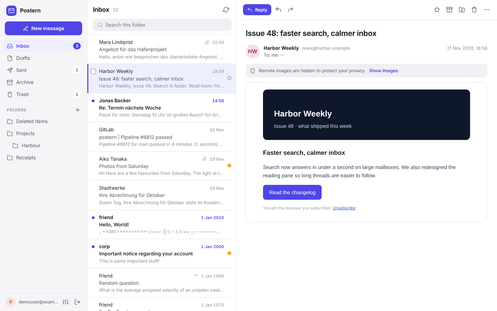

# Postern

Ein kleines, zustandsloses Webmail für beliebige Mailserver mit **IMAP + SMTP** oder **JMAP**.
Ein statisches Rust-Binary liefert die Oberfläche aus und spricht mit deinem Mailserver. Keine Datenbank, kein PHP, keine Plugins.

English version: [README.md](README.md)



Version 0.2.0. Bitte den Abschnitt [Was getestet ist und was nicht](#was-getestet-ist-und-was-nicht) lesen, bevor du es produktiv einsetzt.

## Was es kann

- Anmelden mit E-Mail-Adresse und Passwort; die Domain entscheidet, welcher Mailserver zuständig ist
- Ordner mit Ungelesen-Zählern, Ordner anlegen, umbenennen, löschen
- Nachrichtenliste mit Vorschau, Suche, Mehrfachauswahl, Stern, gelesen/ungelesen, Nachladen beim Scrollen
- Lesen: HTML-Mails in einem abgeschotteten Frame, externe Bilder erst auf Klick, Anhänge, Quelltext, Download als `.eml`
- Schreiben: neue Nachricht, Antworten, Allen antworten, Weiterleiten (mit Anhängen), Cc/Bcc, Anhänge per Klick oder Drag-and-drop, Entwürfe
- Verschieben, Archivieren, Spam, Papierkorb, endgültig löschen
- **S/MIME:** signieren, verschlüsseln oder beides; Signaturen prüfen und eingehende Mails entschlüsseln; eigenen Schlüssel aus einer `.p12`/`.pfx`-Datei importieren; Zertifikate anderer werden aus geprüften Signaturen gesammelt oder von Hand importiert ([Details](#smime))
- **Privatsphäre:** externe Bilder fragen, immer oder nie laden, mit Ausnahmeliste pro Absender; auf Wunsch Klartext statt HTML
- **Benachrichtigungen:** Desktop-Benachrichtigung und Ton bei neuer Mail, Ungelesen-Zahl im Tab-Titel
- Hell/Dunkel, acht Farbthemen, Spalten per Ziehen breiter oder schmaler, kompakte Liste, Deutsch/Englisch, Tastenkürzel, Handy-Layout
- Admin-Konsole für Mailserver und erlaubte Domains, ohne Passwort (Einmal-Link von der Kommandozeile)

Bewusst noch nicht enthalten: HTML-Editor (es wird Klartext geschrieben), Konversationsansicht, Sieve-Filter, Adressbuch, PGP, Push (die Liste aktualisiert sich alle 60 Sekunden), OAuth-Anmeldung.

## Sicherheitsmodell in Kürze

- **Nichts auf der Platte außer Konfiguration.** Im Datenverzeichnis liegen `servers.toml` und `secret.key`. Keine Mails, keine Passwörter, keine Sitzungen.
- **Die Sitzung lebt im Cookie.** Adresse und Passwort stehen verschlüsselt (XChaCha20-Poly1305) in einem `HttpOnly`-, `Secure`-, `SameSite=Strict`-Cookie mit `__Host-`-Präfix. JavaScript kann es nicht lesen. Der Schlüssel verlässt den Server nie.
- **Ehrlich dazu:** IMAP und SMTP brauchen das Passwort bei jeder Verbindung. Postern muss es also bei jeder Anfrage kurz im Speicher haben. Wer gleichzeitig `secret.key` *und* ein Cookie erbeutet, hat das Passwort. Wer nur eines von beiden hat, hat nichts.
- **Feindliche HTML-Mails** laufen durch drei Schichten: Bereinigung auf dem Server (ammonia, Erlaubnisliste), ein `sandbox`-Frame ohne Skript-Rechte, und eine eigene Content-Security-Policy für diesen Frame. Externe Bilder sind aus, bis man sie anfordert.
- **Die Oberfläche** läuft unter strenger CSP (kein Inline-Skript, keine fremden Ursprünge) und erzwungenen Trusted Types.
- **Schreibende Anfragen** brauchen drei Dinge: das Strict-Cookie, einen eigenen Header und einen passenden `Origin`.
- **Anhänge** werden immer als Download ausgeliefert (`application/octet-stream`, `nosniff`, CSP `sandbox`).
- **Anmeldeversuche** sind pro Adresse des Besuchers begrenzt (10 Fehlversuche in 10 Minuten).
- **Admin-Konsole** läuft auf einem eigenen Port, ist nur über Loopback erreichbar und hat kein Passwort.

Sicherheitslücken bitte wie in [SECURITY.md](SECURITY.md) beschrieben melden.

## S/MIME

Postern macht S/MIME auf dem Server, in Rust, ohne OpenSSL. Was es kann:

| | |
| --- | --- |
| Signieren | RSA-Schlüssel (2048–4096 Bit, PKCS#1 v1.5 mit SHA-256) und EC-Schlüssel (P-256, P-384); als `multipart/signed` |
| Verschlüsseln | AES-256-CBC, Schlüsseltransport RSA PKCS#1 v1.5, an alle An- und Cc-Empfänger und an dich selbst, damit die Kopie in „Gesendet“ lesbar bleibt; Entwürfe verschlüsselter Nachrichten werden verschlüsselt für dich abgelegt |
| Prüfen | `multipart/signed` und eingebettete Signaturen, RSA PKCS#1 v1.5 und PSS, ECDSA P-256/P-384; auch BER, wie Outlook und Thunderbird es schreiben |
| Entschlüsseln | AES-128/192/256-CBC und 3DES, RSA PKCS#1 v1.5 und RSA-OAEP |
| Vertrauen | Die Zertifikatskette wird gegen Mozillas Wurzeln für E-Mail geprüft (83 Wurzeln, aus NSS), dazu alles aus `POSTERN_SMIME_CA_FILE`; oder du vertraust einem Zertifikat von Hand |

Wo die Schlüssel liegen:

- **Dein privater Schlüssel** wird einmal pro Browser aus deiner `.p12`/`.pfx`-Datei hochgeladen. Der Server prüft ihn, versiegelt ihn mit seinem eigenen Schlüssel (XChaCha20-Poly1305, an deine Adresse gebunden) und gibt ihn zurück. Der Browser hebt das Siegel auf und schickt es nur bei den Anfragen mit, die es brauchen: eine Nachricht öffnen, senden, Schlüsselprüfung. Weder die Datei noch ihr Passwort werden gespeichert. Wie beim Sitzungs-Cookie gilt: Wer `secret.key` *und* das Siegel hat, hat deinen Schlüssel. Ändert sich der Server-Schlüssel, einfach neu importieren.
- **Zertifikate anderer** sind öffentlich und liegen im Browser. Sie kommen von selbst dazu, wenn eine Nachricht eine gültige Signatur mit einem Zertifikat trägt, das zu einer vertrauenswürdigen Wurzel führt und den Absender nennt; alles andere kannst du von Hand hinzufügen (PEM, DER oder `.p7c`). „Alle exportieren“ schreibt sie als eine PEM-Datei für ein anderes Gerät.
- **Entschlüsselte Inhalte** gibt es nur im Arbeitsspeicher, im selben Zwei-Minuten-Cache wie jede geöffnete Nachricht.

Schutzmaßnahmen:

- Entpackt wird nur die oberste Ebene einer Nachricht, nie ein verschlüsselter Teil irgendwo in einem anderen Multipart (Schutz gegen EFAIL). Entschlüsselte Mails laden externe Bilder nie von selbst, egal was in der Bild-Einstellung steht.
- Schlägt das Entpacken des RSA-Schlüssels fehl, geht es mit einem Zufallsschlüssel weiter, damit eine beschädigte und eine gefälschte Nachricht gleich enden (RFC 3218). Signiert wird mit `ring`, das konstant-zeitig arbeitet. Entschlüsselt wird mit der Bibliothek `rsa`, deren PKCS#1-v1.5-Code bekanntermaßen noch Zeitunterschiede zeigt ([RUSTSEC-2023-0071](https://rustsec.org/advisories/RUSTSEC-2023-0071)); ein Angreifer müsste deinen Server viele ausgesuchte Nachrichten entschlüsseln lassen und die Zeit messen, und das löst nur du aus, eine Nachricht nach der anderen.

Noch nicht unterstützt: Entschlüsseln mit und Verschlüsseln an EC-Schlüssel, AES-GCM (`AuthEnvelopedData`), Sperrprüfung (CRL, OCSP), Bcc zusammen mit Verschlüsselung (wird abgelehnt, weil die Verschlüsselung die Bcc-Empfänger allen verraten würde).

## Schnellstart mit Docker Compose hinter Traefik

Voraussetzung: Traefik läuft bereits, kümmert sich um TLS/ACME und hängt an einem Docker-Netz (hier `proxy`).

```sh
git clone https://github.com/sahelea1/postern-webmail.git && cd postern-webmail
cp .env.example .env          # POSTERN_HOST und die Traefik-Namen eintragen
docker compose up -d --build  # baut das Image (dauert beim ersten Mal einige Minuten)
```

Der Build lädt die Node- und Rust-Images und kompiliert rund 290 Crates. Der Docker-Host sollte dafür einige Gigabyte frei haben. `docker builder prune` gibt den Platz danach zurück; das fertige Image ist etwa 10 MB groß.

Dann den Mailserver eintragen:

```sh
docker compose exec postern /postern admin-link
# gibt http://127.0.0.1:8081/login?token=... aus (10 Minuten gültig, einmal benutzbar)
```

Die Admin-Konsole ist nur auf dem Docker-Host unter `127.0.0.1:8081` erreichbar. Vom eigenen Rechner aus:

```sh
ssh -L 8081:127.0.0.1:8081 dein-host   # danach den Link im Browser öffnen
```

In der Konsole einen Server anlegen, „Test connection“ drücken, speichern. Die Änderung gilt sofort.

Alternativ ohne Konsole: `servers.example.toml` anpassen und als `servers.toml` ins Volume legen:

```sh
docker compose cp servers.toml postern:/data/servers.toml && docker compose restart postern
```

### Was die Compose-Datei festlegt

| Punkt | Einstellung |
| --- | --- |
| Erreichbarkeit | Nur über Traefik (Labels). Kein Port ins Internet veröffentlicht |
| Admin-Port | `127.0.0.1:8081` auf dem Host |
| Härtung | Root-Dateisystem schreibgeschützt, alle Capabilities entfernt, `no-new-privileges`, Benutzer 65532, Image ohne Shell |
| Daten | Benanntes Volume `postern-data` (wenige Kilobyte) |
| Besucher-Adresse | `POSTERN_TRUST_PROXY=1`: aus Traefiks `X-Forwarded-For` |

Dein Mailserver muss vom Container aus erreichbar sein. Am einfachsten über seinen öffentlichen Namen mit gültigem Zertifikat.

## Kubernetes mit Helm

Das Chart liegt in `deploy/helm/postern`. Es bringt Deployment, Service, Ingress und die ACME-Anbindung über cert-manager mit.

```sh
# 1. Image bauen und in eine Registry schieben, die der Cluster erreicht
docker build -t registry.example.com/postern:0.2.0 .
docker push registry.example.com/postern:0.2.0

# 2. Werte anpassen (Host, Mailserver) und installieren
helm install webmail deploy/helm/postern -n mail --create-namespace \
  --set image.repository=registry.example.com/postern \
  --set ingress.host=webmail.example.com \
  --set ingress.className=traefik \
  --set ingress.tls.clusterIssuer=letsencrypt-prod \
  --set-file servers=servers.toml
```

Varianten für das Zertifikat:

| Situation | Werte |
| --- | --- |
| cert-manager mit vorhandenem `ClusterIssuer` | `ingress.tls.clusterIssuer=letsencrypt-prod` |
| cert-manager, Chart soll einen Let's-Encrypt-`Issuer` anlegen | `acme.createIssuer=true`, `acme.email=du@example.com` |
| Traefik mit eigenem ACME-Resolver | `ingress.annotations."traefik\.ingress\.kubernetes\.io/router\.tls\.certresolver"=letsencrypt` |
| Zertifikat liegt schon als Secret vor | `ingress.tls.secretName=mein-tls` |

Weitere Punkte:

- Die Mailserver stehen als `servers` in den Werten (ConfigMap). Eine Änderung startet den Pod neu.
- Der Cookie-Schlüssel wird beim ersten Install erzeugt und bei Upgrades behalten. Mit Argo CD oder `helm template` bitte `secretKey.existingSecret` setzen, sonst meldet jeder Sync alle ab.
- Admin-Konsole im Cluster: `admin.enabled=true`, dann `kubectl port-forward deploy/webmail-postern 8081:8081`. Soll sie die Serverliste ändern dürfen: `servers=""` und `persistence.enabled=true`.
- Mit ingress-nginx setzt das Chart die Upload-Grenze passend zu `maxUploadMb`.

## Konfiguration

### Umgebungsvariablen

| Variable | Standard | Bedeutung |
| --- | --- | --- |
| `POSTERN_LISTEN` | `0.0.0.0:8080` | Adresse der Web-Oberfläche (HTTP; TLS macht der Proxy davor) |
| `POSTERN_ADMIN_LISTEN` | `127.0.0.1:8081` | Adresse der Admin-Konsole, `off` schaltet sie ab |
| `POSTERN_ADMIN_URL` | `http://127.0.0.1:8081` | Basis der Links, die `admin-link` ausgibt |
| `POSTERN_DATA_DIR` | `./data` | Verzeichnis für `servers.toml` und `secret.key` |
| `POSTERN_SERVERS_FILE` | leer | Serverliste aus dieser Datei lesen; die Konsole kann sie dann nicht ändern |
| `POSTERN_SERVERS_SEED` | leer | Startliste: wird beim ersten Start nach `servers.toml` kopiert, falls dort noch keine liegt. Danach nie wieder |
| `POSTERN_SECRET_KEY` | leer | Cookie-Schlüssel als 64 Hex-Zeichen statt `secret.key` |
| `POSTERN_TRUST_PROXY` | `0` | Besucher-Adresse aus `X-Forwarded-For` nehmen. Hinter einem Proxy auf `1` setzen |
| `POSTERN_SESSION_HOURS` | `168` | Gültigkeit einer Anmeldung |
| `POSTERN_MAX_UPLOAD_MB` | `25` | Anhänge pro Nachricht insgesamt |
| `POSTERN_BRAND` | `Postern` | Name in der Oberfläche |
| `POSTERN_CA_FILE` | leer | Zusätzliche Zertifizierungsstellen (PEM) für interne Mailserver |
| `POSTERN_SMIME_CA_FILE` | leer | Zusätzliche Wurzeln (PEM) für S/MIME-Signaturen, neben Mozillas eingebauter Liste. Für eine Firmen-CA |
| `POSTERN_LOG` | `info` | `error`, `warn`, `info`, `debug` |
| `POSTERN_INSECURE_HTTP` | `0` | Nur für lokale Entwicklung: Cookies ohne `Secure` |

Wichtig: Ohne `POSTERN_TRUST_PROXY=1` sieht Postern hinter einem Proxy nur dessen Adresse. Dann teilen sich alle Besucher ein Anmelde-Limit.

### `servers.toml`

Siehe `servers.example.toml`. Pro Server: eine Kennung, die erlaubten Domains, das Protokoll und die Adressen. `*.example.com` passt auf Subdomains, `*` auf alles. Eine Adresse, deren Domain nirgends steht, kann sich nicht anmelden.

### Hinweise zu Stalwart

- Beide Wege gehen: `protocol = "imap"` (993/465) oder `protocol = "jmap"` mit `jmap_url = "https://mail.example.com"`.
- Mit aktivierter Zwei-Faktor-Anmeldung braucht man ein App-Passwort, weil Postern sich mit Passwort anmeldet.
- Der IMAP-Weg ist gegen einen echten IMAP-Server getestet, der JMAP-Weg nur gegen einen Testserver nach RFC (siehe unten). Für den Start empfehle ich IMAP und JMAP danach an einem Testkonto auszuprobieren.

## Befehle

```
postern [run]        Server starten
postern admin-link   Einmal-Link für die Admin-Konsole ausgeben
postern check        servers.toml prüfen
postern healthcheck  Exit 0, wenn der lokale Server antwortet
postern version
```

## Aufbau

```
src/
  main.rs           Start, Kommandozeile
  config.rs         Umgebungsvariablen, servers.toml
  seal.rs           Verschlüsselung der Cookies
  state.rs          Sitzung, Anmelde-Limit, kurzlebiger Nachrichten-Cache (2 Minuten, nur im Speicher)
  api.rs            JSON-API, Schutz gegen Cross-Site-Anfragen, Sicherheits-Header
  message.rs        Mails parsen, HTML bereinigen, Nachrichten bauen
  smime/            S/MIME: CMS lesen und schreiben, Kettenprüfung, roots.pem (Mozilla)
  backend/imap.rs   IMAP + SMTP
  backend/jmap.rs   JMAP
  admin.rs          Admin-Konsole
  assets.rs         eingebettete Oberfläche
web/src/            Oberfläche (TypeScript, Preact, Signals), gebaut mit esbuild
web/admin/          Admin-Konsole (reines JavaScript, kein Build)
deploy/helm/        Helm-Chart
tests/              End-to-End- und Browser-Tests samt Testservern
```

Rund 7.500 Zeilen Rust (inklusive Unit-Tests; 1.900 davon S/MIME) und 3.600 Zeilen TypeScript. In den eigenen Crates ist `unsafe` verboten. Die Oberfläche hat zwei Laufzeit-Abhängigkeiten (Preact, Signals), der Build acht npm-Pakete insgesamt.

## Selbst bauen und testen

```sh
cd web && npm ci --ignore-scripts && node build.mjs && cd ..
cargo build --release
cargo test --release
```

Die End-to-End-Tests starten echte Testserver und steuern das Gateway über HTTP:

```sh
pip install -r tests/requirements.txt
tests/e2e.sh imap    # pymap (IMAP) und ein SMTP-Server mit Anmeldung
tests/e2e.sh jmap    # tests/jmap_mock.py
tests/smime.sh       # S/MIME gegen OpenSSL, in beide Richtungen
```

Die Browser-Tests (`tests/browser*.py`) brauchen Playwright mit Chrome und ein laufendes Gateway; der Aufruf steht jeweils in den ersten Zeilen der Datei.

## Was getestet ist und was nicht

Läuft bei jedem Push in der [CI](.github/workflows/ci.yml):

| Bereich | Wie | Ergebnis |
| --- | --- | --- |
| Rust-Unit-Tests | `cargo test`: Cookie-Verschlüsselung, Konfiguration, HTML-Bereinigung, Nachrichtenbau, Eingabeprüfung, ASN.1 | 44 von 44 |
| API über IMAP + SMTP | `tests/e2e.py` gegen einen echten IMAP-Server (pymap) und einen SMTP-Server mit Anmeldung | 107 von 107 |
| API über JMAP | `tests/e2e.py` gegen `tests/jmap_mock.py` | 102 von 102 |
| S/MIME | `tests/smime.sh`: Nachrichten von `openssl cms` (multipart/signed, eingebettet, BER, LF und CRLF, AES, 3DES, OAEP, erst signiert dann verschlüsselt, ECDSA, manipuliert, unbekannter Unterzeichner, falscher Absender) liest Postern; Nachrichten von Postern prüft `openssl cms -verify` und `-decrypt`; Entwürfe, Weiterleiten, Fehlerfälle | 67 von 67 |
| Container-Image | `docker build`, danach Start mit schreibgeschütztem Dateisystem und ohne Capabilities, Abfrage von `/healthz` | besteht |
| Helm-Chart | `helm lint` und `helm template` in mehreren Konfigurationen | besteht |

Von Hand während der Entwicklung, nicht in der CI:

| Bereich | Wie | Ergebnis |
| --- | --- | --- |
| TLS | IMAP und SMTP über TLS und STARTTLS: Zertifikats- und Hostnamen-Prüfung, eigene CA | bestanden, 3 Läufe in Folge (mit 0.1.0) |
| Oberfläche | `tests/browser.py` in Chrome: anmelden, lesen, schreiben, senden, suchen, verschieben, Ordner, Einstellungen, Handy-Ansicht; jeder Konsolenfehler (auch CSP/Trusted Types) lässt den Test scheitern | bestanden |
| Feindliche Mail | `tests/browser_hostile.py`: über 50 Tracking- und Skript-Tricks in einer Mail, in Chrome geöffnet | kein Skript, keine einzige Anfrage an fremde Hosts, nach Freigabe nur Bilder |
| Admin-Konsole | `tests/browser_admin.py` und API-Checks | bestanden |
| Neu in 0.2 | `tests/browser_features.py`: Spalten ziehen (Maus und Tasten, bleibt nach Neuladen), Farbthemen, Bild-Einstellungen, Benachrichtigung und Ton bei Tab im Hintergrund, Schlüssel und Zertifikat importieren, signiert und verschlüsselt senden und wieder lesen, Zertifikat vertrauen, Listenabfragen tragen nie den Schlüssel, Abmelden unter einer Sekunde mit erhaltenen lokalen Einstellungen | bestanden |

Nicht getestet, bitte selbst prüfen:

- **Echte Mailserver.** Der IMAP-Weg lief gegen pymap, nicht gegen Stalwart, Dovecot oder Gmail. Der JMAP-Weg ist nur gegen einen selbst geschriebenen Testserver nach RFC 8620/8621 geprüft.
- **S/MIME mit echten Mailprogrammen.** Geprüft ist die Zusammenarbeit mit OpenSSL, mit dem Thunderbird und Outlook bei diesen Formaten übereinstimmen, aber nicht mit Outlook, Apple Mail oder Thunderbird selbst und nicht mit Zertifikaten einer öffentlichen CA.
- **Echtes Traefik und ein echter Cluster.** Labels und Chart sind nach Dokumentation geschrieben; das Chart wird geprüft und gerendert, aber nicht installiert.
- **Last und große Postfächer.** Die Liste lädt alle UIDs eines Ordners und zeigt 50 pro Seite. Bei sehr großen Ordnern ist das nicht gemessen.
- **Eine unabhängige Sicherheitsprüfung.** Die gibt es nicht. Der Code ist mit KI-Unterstützung entstanden, und die Tests oben sind die des Projekts selbst.

Empfehlung: erst neben dem bisherigen Webmail auf eigenem Hostnamen betreiben, mit einem Testkonto alle Wege durchspielen, dann umstellen.

## Bekannte Grenzen

- Abmelden macht das Cookie auf diesem Server sofort ungültig (Liste im Speicher). Nach einem Neustart ist die Liste leer; ein vorher gestohlenes Cookie gälte dann bis zu seinem Ablauf. Passwort ändern beendet alles.
- Ohne IMAP-Erweiterung `SORT` ist die Liste nach Eingang (UID) sortiert, nicht nach Datum im Header.
- Einstellungen, dein versiegelter S/MIME-Schlüssel und gespeicherte Zertifikate liegen im Browser (`localStorage`), nicht auf dem Server; jedes Gerät hat also seine eigenen.
- Benachrichtigungen brauchen einen offenen Tab; Push gibt es noch nicht. Manche Handy-Browser zeigen von Webseiten gar keine Benachrichtigungen.
- Mehrere Replikas: Anmelde-Limit und Abmelde-Liste gelten pro Prozess.

## Fremde Bestandteile

- Icons: Feather (MIT)
- Schrift: Inter (SIL Open Font License 1.1)
- Rust-Crates und npm-Pakete: siehe `Cargo.lock` und `web/package-lock.json`
