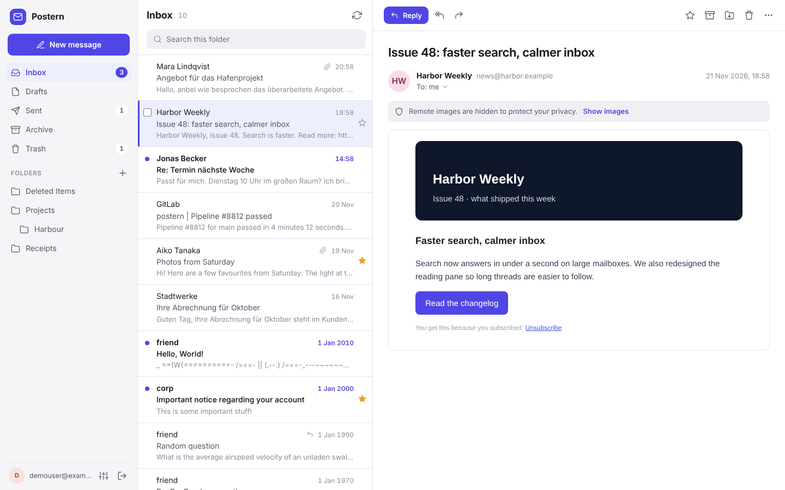
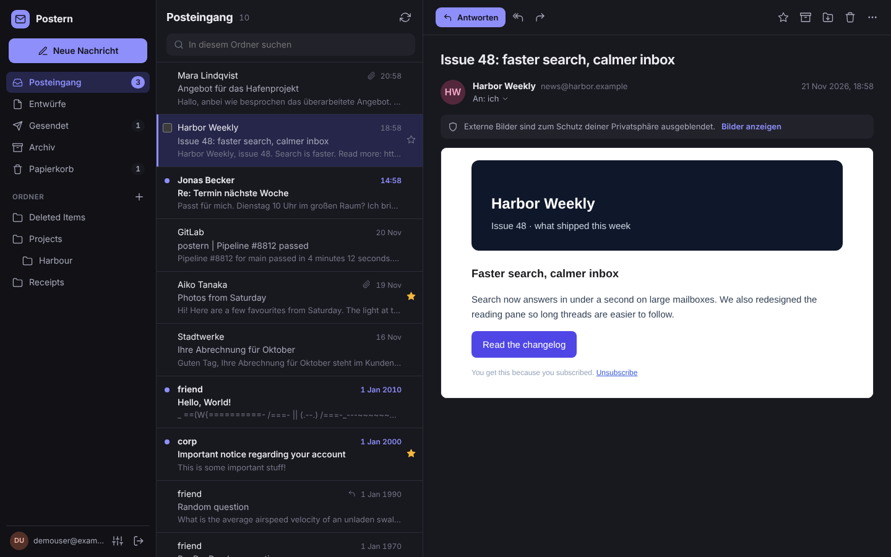
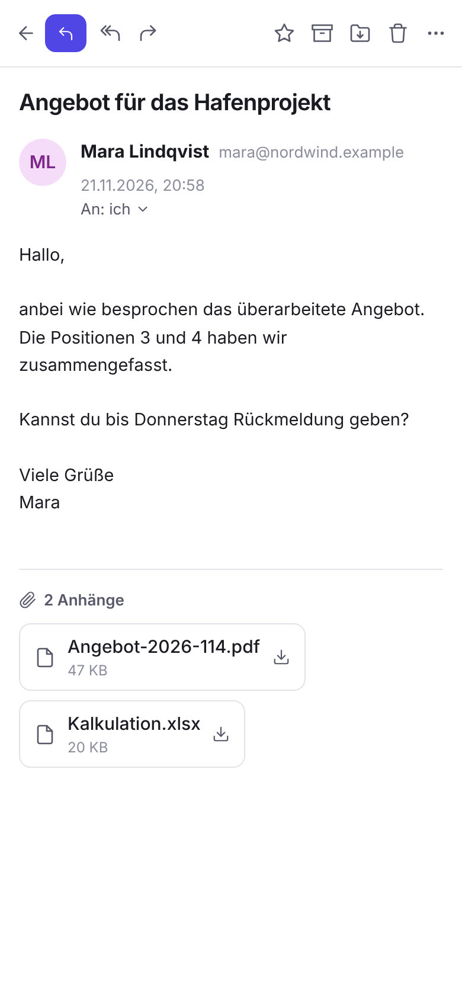

# Postern

A small, stateless webmail for any mail server that speaks **IMAP + SMTP** or **JMAP**.

One static Rust binary serves the web client and talks to your mail server. No database, no PHP, no plugins. It stores no mail and no passwords: the only things on disk are the server list and one key.

[](https://github.com/sahelea1/postern-webmail/actions/workflows/ci.yml)

Deutsche Fassung: [README.de.md](README.de.md)



| Dark theme | Phone |
| --- | --- |
|  |  |

## Status

Version 0.2.0. Early, and honest about it: the test suite is broad, but the project has not been run against many real mail servers and has had no independent security review. Read [What is tested and what is not](#what-is-tested-and-what-is-not) before you put it in front of users.

## Features

- Sign in with email address and password; the address's domain decides which mail server is used
- Folders with unread counts; create, rename and delete folders
- Message list with preview, search, multi-select, star, read/unread, loading more on scroll
- Reading: HTML mail in a locked-down frame, remote images only on request, attachments, message source, download as `.eml`
- Writing: new message, reply, reply all, forward (with attachments), Cc/Bcc, attachments by click or drag and drop, drafts
- Move, archive, spam, trash, delete for good
- **S/MIME:** sign, encrypt, or both; verify signatures and decrypt incoming mail; import your key from a `.p12`/`.pfx` file; certificates of other people are collected from verified signatures or imported by hand ([details](#smime))
- **Privacy:** remote images ask, always or never, with a per-sender allow list; plain text instead of HTML if you prefer
- **Notifications:** desktop notifications and a sound for new mail, unread count in the tab title
- Light and dark mode, eight colour themes, columns you can drag wider or narrower, compact list, English and German, keyboard shortcuts, phone layout
- Admin console for mail servers and allowed domains, with no password of its own (one-time link from the command line)

Left out on purpose so far: HTML editor (you write plain text), conversation view, Sieve filters, address book, PGP, push (the list refreshes every 60 seconds), OAuth sign-in.

## Security model

- **Nothing on disk but configuration.** The data directory holds `servers.toml` and `secret.key`. No mail, no passwords, no sessions.
- **The session lives in the cookie.** Address and password are encrypted (XChaCha20-Poly1305) into an `HttpOnly`, `Secure`, `SameSite=Strict` cookie with the `__Host-` prefix. JavaScript cannot read it. The key never leaves the server.
- **The trade-off, stated plainly:** IMAP and SMTP need the password for every connection, so Postern holds it in memory for the length of each request. Whoever steals `secret.key` *and* a cookie has the password. Either one alone is worthless.
- **Hostile HTML mail** passes three layers: an allow-list sanitizer on the server (ammonia), a `sandbox` frame without script rights, and a separate Content Security Policy for that frame. Remote images stay off until you ask for them.
- **The client** runs under a strict CSP (no inline script, no foreign origins) with Trusted Types enforced.
- **State-changing requests** need three things: the strict cookie, a custom header and a matching `Origin`.
- **Attachments** are always served as downloads (`application/octet-stream`, `nosniff`, CSP `sandbox`).
- **Sign-in attempts** are limited per visitor address (10 failures in 10 minutes).
- **The admin console** listens on its own port, is meant for loopback only, and has no password. You get in with a single-use link printed by `postern admin-link`.

To report a vulnerability, see [SECURITY.md](SECURITY.md).

## S/MIME

Postern does S/MIME on the server, in Rust, without OpenSSL. What it can do:

| | |
| --- | --- |
| Sign | RSA (2048–4096 bit, PKCS#1 v1.5 with SHA-256) and EC (P-256, P-384) keys; clear-signed `multipart/signed` |
| Encrypt | AES-256-CBC, key transport RSA PKCS#1 v1.5, to every To and Cc recipient plus yourself, so the Sent copy stays readable; drafts of encrypted messages are stored encrypted to you |
| Verify | clear-signed and opaque signatures, RSA PKCS#1 v1.5 and PSS, ECDSA P-256/P-384; BER as Outlook and Thunderbird write it |
| Decrypt | AES-128/192/256-CBC and 3DES, RSA PKCS#1 v1.5 and RSA-OAEP |
| Trust | the certificate chain is checked against Mozilla's roots for e-mail (83 roots, from NSS), plus any file in `POSTERN_SMIME_CA_FILE`; or you trust a certificate by hand |

Where the keys are:

- **Your private key** is uploaded once per browser from your `.p12`/`.pfx` file. The server checks it, seals it with its own key (XChaCha20-Poly1305, bound to your address) and hands it back. The browser keeps the sealed blob and sends it in a header only with the requests that need it: opening a message, sending, and the key check. Neither the file nor its password is stored. As with the session cookie: whoever has `secret.key` *and* the sealed blob has your key. If the server key changes, import again.
- **Certificates of other people** are public and live in the browser. They are added by themselves when a message carries a valid signature from a certificate that chains to a trusted root and names the sender; anything else you can add by hand (PEM, DER or `.p7c`). "Export all" writes them as one PEM file to take to another device.
- **Decrypted content** exists only in memory, in the same two-minute cache as any opened message.

Defences:

- Only the top level of a message is unwrapped, never an encrypted part inside some other multipart (the EFAIL defence). Decrypted mail never loads remote images by itself, whatever the image setting says.
- A failed RSA key unwrap continues with a random key, so a damaged and a forged message end the same way (RFC 3218). Signing uses `ring`, which is constant-time. Decryption uses the `rsa` crate, whose PKCS#1 v1.5 code is still known to leak timing ([RUSTSEC-2023-0071](https://rustsec.org/advisories/RUSTSEC-2023-0071)); an attacker would have to make your server decrypt many chosen messages and time it, which only you can trigger, one message at a time.

Not supported yet: decrypting with or encrypting to EC keys, AES-GCM (`AuthEnvelopedData`), revocation checks (CRL, OCSP), Bcc together with encryption (refused, because the encryption would name the Bcc recipients to everyone).

## Quick start: Docker Compose behind Traefik

You need a running Traefik that handles TLS/ACME and is attached to a Docker network (here `proxy`).

```sh
git clone https://github.com/sahelea1/postern-webmail.git && cd postern-webmail
cp .env.example .env          # set POSTERN_HOST and your Traefik names
docker compose up -d --build  # builds the image; the first build takes a few minutes
```

The build pulls the Node and Rust images and compiles about 290 crates, so give the Docker host a few gigabytes of free disk space. `docker builder prune` gives it back afterwards; the finished image is roughly 10 MB.

Then add your mail server:

```sh
docker compose exec postern /postern admin-link
# prints http://127.0.0.1:8081/login?token=...   (valid for 10 minutes, works once)
```

The admin console is reachable only on the Docker host at `127.0.0.1:8081`. From your own machine:

```sh
ssh -L 8081:127.0.0.1:8081 your-host   # then open the link in your browser
```

Add a server in the console, press "Test connection", save. The change applies at once.

Without the console: edit `servers.example.toml` and put it into the volume as `servers.toml`:

```sh
docker compose cp servers.toml postern:/data/servers.toml && docker compose restart postern
```

### What the Compose file sets

| Topic | Setting |
| --- | --- |
| Exposure | Through Traefik only (labels). No port is published to the internet |
| Admin port | `127.0.0.1:8081` on the host |
| Hardening | Read-only root file system, all capabilities dropped, `no-new-privileges`, user 65532, image without a shell |
| Data | Named volume `postern-data` (a few kilobytes) |
| Visitor address | `POSTERN_TRUST_PROXY=1`: taken from Traefik's `X-Forwarded-For` |

The container must be able to reach your mail server. The simplest way is its public name with a valid certificate.

## Kubernetes with Helm

The chart is in `deploy/helm/postern`. It brings a Deployment, Service, Ingress and the ACME hookup through cert-manager.

```sh
# 1. Build the image and push it to a registry your cluster can reach
docker build -t registry.example.com/postern:0.2.0 .
docker push registry.example.com/postern:0.2.0

# 2. Set your values (host, mail servers) and install
helm install webmail deploy/helm/postern -n mail --create-namespace \
  --set image.repository=registry.example.com/postern \
  --set ingress.host=webmail.example.com \
  --set ingress.className=traefik \
  --set ingress.tls.clusterIssuer=letsencrypt-prod \
  --set-file servers=servers.toml
```

Certificate options:

| Situation | Values |
| --- | --- |
| cert-manager with an existing `ClusterIssuer` | `ingress.tls.clusterIssuer=letsencrypt-prod` |
| cert-manager, the chart creates a Let's Encrypt `Issuer` | `acme.createIssuer=true`, `acme.email=you@example.com` |
| Traefik with its own ACME resolver | `ingress.annotations."traefik\.ingress\.kubernetes\.io/router\.tls\.certresolver"=letsencrypt` |
| The certificate already exists as a Secret | `ingress.tls.secretName=my-tls` |

More to know:

- The mail servers are the `servers` value (a ConfigMap). Changing it restarts the pod.
- The cookie key is created on first install and kept on upgrades. With Argo CD or `helm template`, set `secretKey.existingSecret`, or every sync signs everyone out.
- Admin console in the cluster: `admin.enabled=true`, then `kubectl port-forward deploy/webmail-postern 8081:8081`. To let it change the server list: `servers=""` and `persistence.enabled=true`.
- With ingress-nginx the chart sets the upload limit to match `maxUploadMb`.

## Configuration

### Environment variables

| Variable | Default | Meaning |
| --- | --- | --- |
| `POSTERN_LISTEN` | `0.0.0.0:8080` | Address of the web client (HTTP; the proxy in front does TLS) |
| `POSTERN_ADMIN_LISTEN` | `127.0.0.1:8081` | Address of the admin console; `off` disables it |
| `POSTERN_ADMIN_URL` | `http://127.0.0.1:8081` | Base of the links printed by `admin-link` |
| `POSTERN_DATA_DIR` | `./data` | Directory for `servers.toml` and `secret.key` |
| `POSTERN_SERVERS_FILE` | empty | Read the server list from this file; the console can then not change it |
| `POSTERN_SERVERS_SEED` | empty | Starter list: copied to `servers.toml` on the first start if none exists yet, and never again |
| `POSTERN_SECRET_KEY` | empty | Cookie key as 64 hex characters, instead of `secret.key` |
| `POSTERN_TRUST_PROXY` | `0` | Take the visitor address from `X-Forwarded-For`. Set to `1` behind a proxy |
| `POSTERN_SESSION_HOURS` | `168` | How long a sign-in lasts |
| `POSTERN_MAX_UPLOAD_MB` | `25` | Total attachment size per message |
| `POSTERN_BRAND` | `Postern` | Name shown in the client |
| `POSTERN_CA_FILE` | empty | Extra certificate authorities (PEM) for internal mail servers |
| `POSTERN_SMIME_CA_FILE` | empty | Extra roots (PEM) for S/MIME signatures, next to the built-in Mozilla list. For a company CA |
| `POSTERN_LOG` | `info` | `error`, `warn`, `info`, `debug` |
| `POSTERN_INSECURE_HTTP` | `0` | Local development only: cookies without `Secure` |

Behind a proxy, set `POSTERN_TRUST_PROXY=1`. Without it Postern sees only the proxy's address, and all visitors share one sign-in limit.

### `servers.toml`

See [`servers.example.toml`](servers.example.toml). Each server has an id, the domains allowed to use it, a protocol and its addresses. `*.example.com` matches subdomains, `*` matches everything. An address whose domain is listed nowhere cannot sign in.

### Notes for Stalwart

- Both ways are supported: `protocol = "imap"` (993/465) or `protocol = "jmap"` with `jmap_url = "https://mail.example.com"`.
- With two-factor sign-in enabled you need an app password, because Postern signs in with a password.
- The IMAP path is tested against a real IMAP server, the JMAP path only against a test server written from the RFCs (see below). Start with IMAP and try JMAP on a test account.

## Commands

```
postern [run]        start the server
postern admin-link   print a single-use link for the admin console
postern check        validate servers.toml
postern healthcheck  exit 0 if the local server answers
postern version
```

## Layout

```
src/
  main.rs           start-up, command line
  config.rs         environment variables, servers.toml
  seal.rs           cookie encryption
  state.rs          session, sign-in limit, short-lived message cache (2 minutes, memory only)
  api.rs            JSON API, cross-site request defence, security headers
  message.rs        parsing mail, sanitizing HTML, building messages
  smime/            S/MIME: CMS reading and writing, chain checks, roots.pem (Mozilla)
  backend/imap.rs   IMAP + SMTP
  backend/jmap.rs   JMAP
  admin.rs          admin console
  assets.rs         embedded web client
web/src/            web client (TypeScript, Preact, Signals), built with esbuild
web/admin/          admin console (plain JavaScript, no build step)
deploy/helm/        Helm chart
tests/              end-to-end and browser tests with their test servers
```

About 7,500 lines of Rust (unit tests included; 1,900 of them S/MIME) and 3,600 lines of TypeScript. `unsafe` is forbidden in the project's own code. The client has two runtime dependencies (Preact, Signals); the build uses eight npm packages in total.

## Build and test

```sh
cd web && npm ci --ignore-scripts && node build.mjs && cd ..
cargo build --release
cargo test --release
```

The end-to-end suite starts real test servers and drives the gateway over HTTP:

```sh
pip install -r tests/requirements.txt
tests/e2e.sh imap    # pymap (IMAP) and an SMTP server that requires sign-in
tests/e2e.sh jmap    # tests/jmap_mock.py
tests/smime.sh       # S/MIME against OpenSSL, in both directions
```

The browser tests (`tests/browser*.py`) need Playwright with Chrome and a running gateway; each file's first lines say how to call it.

## What is tested and what is not

Run on every push by [CI](.github/workflows/ci.yml):

| Area | How | Result |
| --- | --- | --- |
| Rust unit tests | `cargo test`: cookie encryption, configuration, HTML sanitizing, message building, input checks, ASN.1 | 44 of 44 |
| API over IMAP + SMTP | `tests/e2e.py` against a real IMAP server (pymap) and an SMTP server with sign-in | 107 of 107 |
| API over JMAP | `tests/e2e.py` against `tests/jmap_mock.py` | 102 of 102 |
| S/MIME | `tests/smime.sh`: messages made by `openssl cms` (clear-signed, opaque, BER, LF and CRLF, AES, 3DES, OAEP, sign-then-encrypt, ECDSA, tampered, unknown signer, wrong sender) read by Postern; messages from Postern checked by `openssl cms -verify` and `-decrypt`; drafts, forwarding, error cases | 67 of 67 |
| Container image | `docker build`, then start it read-only without capabilities and ask it for `/healthz` | passes |
| Helm chart | `helm lint` and `helm template` in several configurations | passes |

Run by hand during development, not in CI:

| Area | How | Result |
| --- | --- | --- |
| TLS | IMAP and SMTP over TLS and STARTTLS: certificate and host name checks, private CA | passed, 3 runs in a row (on 0.1.0) |
| Web client | `tests/browser.py` in Chrome: sign in, read, write, send, search, move, folders, settings, phone view; any console error (CSP and Trusted Types included) fails the test | passed |
| Hostile mail | `tests/browser_hostile.py`: more than 50 tracking and script tricks in one message, opened in Chrome | no script ran, no request left for a foreign host; after allowing images, only images |
| Admin console | `tests/browser_admin.py` and API checks | passed |
| New in 0.2 | `tests/browser_features.py`: dragging columns (mouse and keys, kept after reload), colour themes, image settings, notifications and sound with the tab in the background, importing a key and a certificate, sending signed and encrypted mail and reading it back, trusting a certificate, that lists never carry the key, sign-out in under a second with local settings kept | passed |

Not tested. Please check these yourself:

- **Real mail servers.** The IMAP path ran against pymap, not against Stalwart, Dovecot or Gmail. The JMAP path ran only against a test server written from RFC 8620/8621.
- **S/MIME with real mail clients.** Interoperability is tested against OpenSSL, which Thunderbird and Outlook agree with on these formats, but not against Outlook, Apple Mail or Thunderbird themselves, and not with certificates from a public CA.
- **A real Traefik and a real cluster.** The labels and the chart follow the documentation; the chart is linted and rendered, not installed.
- **Load and large mailboxes.** The list loads all UIDs of a folder and shows 50 per page. Very large folders have not been measured.
- **An independent security review.** There is none. The code was written with AI assistance and the tests above are the project's own.

Suggested path: run it next to your current webmail on its own host name, walk through everything with a test account, then switch.

## Known limits

- Signing out invalidates the cookie on this server at once (a list in memory). After a restart the list is empty, so a cookie stolen earlier would work until it expires. Changing the password ends everything.
- Without the IMAP `SORT` extension the list is ordered by arrival (UID), not by the date header.
- Settings, your sealed S/MIME key and saved certificates are kept in the browser (`localStorage`), not on the server, so each device has its own.
- Notifications need the tab to be open; there is no push yet. Some mobile browsers do not show notifications from a page at all.
- Several replicas: the sign-in limit and the sign-out list are per process.

## Third-party parts

- Icons: Feather (MIT)
- Typeface: Inter (SIL Open Font License 1.1)
- Rust crates and npm packages: see `Cargo.lock` and `web/package-lock.json`
